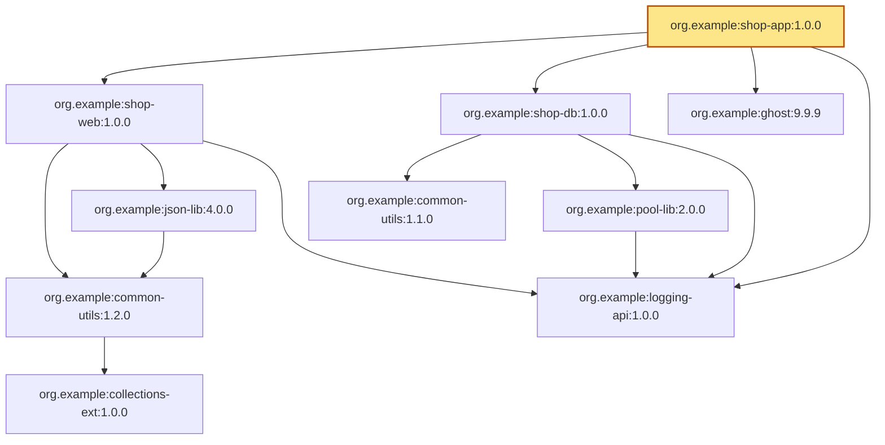
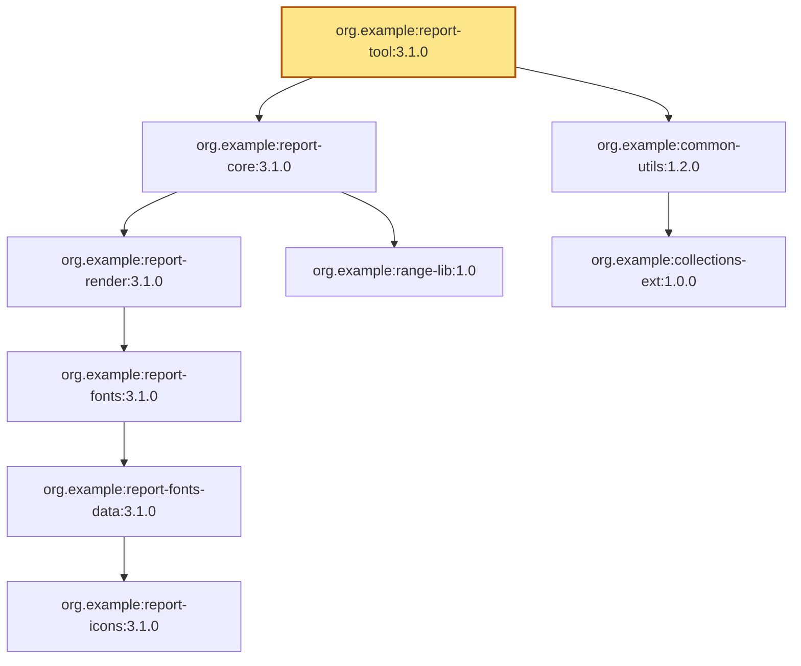
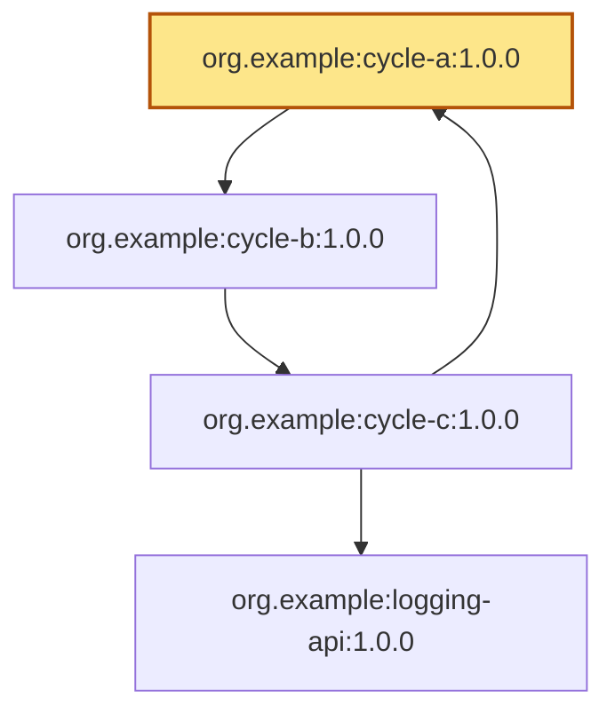

# depgraph — визуализатор графа зависимостей Maven

Практическая работа №2 по дисциплине «Конфигурационное управление»,
вариант 19. Инструмент строит граф зависимостей пакета Java (Maven) и
рисует его. Менеджеры пакетов и библиотеки для получения зависимостей не
используются: POM-файлы читаются и разбираются самостоятельно. Приложение
написано на Python 3.10+ и использует только стандартную библиотеку.

Состояние работы: **этап 5 — визуализация** (Mermaid и PNG). Все этапы
задания выполнены.

## 1. Общее описание

Приложение запускается из командной строки и настраивается только её
опциями. Оно скачивает POM-файлы пакета и его зависимостей из репозитория
Maven (по URL `http`, `https` или `file`), строит граф зависимостей с учётом
транзитивности и печатает его: уровни, зависимости и циклы.

Граф строится обходом в ширину (BFS) без рекурсии. Максимальная глубина и
фильтр по подстроке задаются пользователем, циклические зависимости
обрабатываются корректно. Вместо реального репозитория можно указать файл
тестового репозитория, где пакеты называются большими латинскими буквами.
Режим `--reverse` печатает обратные зависимости: пакеты, которые зависят
от заданного. Опция `--draw` сохраняет граф в виде текста на языке диаграмм
Mermaid и рисует PNG-изображение.

## 2. Описание функций и настроек

| Опция               | Описание                                      | По умолчанию        |
|---------------------|-----------------------------------------------|---------------------|
| `-p`, `--package`   | анализируемый пакет (см. ниже)                | обязательна         |
| `-r`, `--repo`      | URL репозитория или файл тестового репозитория| Maven Central       |
| `-m`, `--mode`      | `url` — репозиторий Maven, `test` — файл      | `url`               |
| `-o`, `--output`    | имя PNG-файла с изображением графа            | `graph.png`         |
| `-d`, `--max-depth` | максимальная глубина анализа (целое число ≥ 1)| `3`                 |
| `-f`, `--filter`    | пропускать пакеты, в имени которых есть строка| пусто (нет фильтра) |
| `-R`, `--reverse`   | печатать обратные зависимости этого пакета    | выключено           |
| `--draw`            | сохранить граф как Mermaid-текст и PNG        | выключено           |
| `--renderer`        | `auto`, `mmdc` или `online` (см. «Визуализация»)| `auto`            |

* `--package`: в режиме `url` — `groupId:artifactId:version`, в режиме
  `test` — имя из больших латинских букв, например `A`;
* `--repo`: URL со схемой `http`, `https` или `file`; по умолчанию
  `https://repo1.maven.org/maven2`; в режиме `test` — путь к файлу
  тестового репозитория (обязателен).

Проверка параметров. При ошибке печатается сообщение `error: ...` в stderr:

* пакет: в режиме `url` нужны три непустые части `groupId:artifactId:version`
  из букв, цифр и символов `._-`; в режиме `test` — только `A`–`Z`;
* репозиторий: допустимы схемы `http`, `https`, `file`, у `http(s)` должен
  быть хост; в режиме `test` обязателен существующий читаемый файл;
* режим: только `url` или `test`;
* изображение: расширение `.png`, существующий и доступный для записи каталог;
* глубина: целое число не меньше 1;
* `--reverse`: имя в том же формате, что у пакета для выбранного режима;
* `--renderer`: только `auto`, `mmdc` или `online`;
* `--draw` нельзя сочетать с `--reverse`.

Граф: корень имеет глубину 0, его прямые зависимости — глубину 1 и так далее.
Пакеты глубже `--max-depth` не посещаются. Пакет, имя которого (для Maven
`groupId:artifactId`, без версии) содержит строку `--filter`, и всё, что
доступно только через него, в граф не попадает. Если фильтру соответствует
сам анализируемый пакет, это ошибка параметров.

Коды завершения: `0` — успех, `1` — ошибка репозитория (пакет не найден,
нет сети, неверный POM), `2` — неверные параметры, `3` — не удалось
нарисовать или сохранить изображение (Mermaid-текст при этом сохраняется).

### Как читаются зависимости Maven

URL POM-файла: `<репозиторий>/<groupId с / вместо .>/<artifactId>/<версия>/<artifactId>-<версия>.pom`.
Реализованы правила Maven, нужные для прямых зависимостей:

* **родительские POM** (`<parent>`): свойства и `<dependencies>` родителей
  наследуются, зависимость потомка скрывает такую же зависимость родителя;
* **свойства**: `${имя}` берётся из `<properties>` пакета и его родителей, а
  также `${project.version}`, `${project.groupId}`, `${project.parent.version}`
  и аналогичные (`pom.*`, `parent.*`);
* **версия не указана**: берётся из `<dependencyManagement>` пакета и его
  родителей, включая импортируемые BOM (`<scope>import</scope>`, `<type>pom</type>`);
* **диапазон версий** `[1.0,2.0)` заменяется нижней границей `1.0`;
* учитываются только зависимости с областью `compile` (по умолчанию) и
  `runtime`, помеченные `optional` пропускаются; `test`, `provided` и
  `system` в граф не попадают;
* зависимость без определимой версии пропускается с предупреждением
  `warning:` в stderr.

Узел графа — `groupId:artifactId:version`. Разные версии одного пакета
(например, `common-utils:1.1.0` и `common-utils:1.2.0`) — разные узлы.
Если POM зависимости не найден, пакет остаётся в графе без зависимостей, а
в stderr печатается `warning:`. Для самого анализируемого пакета это ошибка.

Не поддерживаются `<exclusions>`, профили, SNAPSHOT-метаданные, `RELEASE` и
`LATEST`, классификаторы.

### Тестовый репозиторий

Режим `--mode test` читает файл, в каждой строке которого описан один пакет:

```text
# комментарий
A: B C
B: D
C: D
D:
```

Имена состоят из заглавных букв `A`–`Z`. Пакет, который встречается только в
списке зависимостей, считается пакетом без зависимостей. Пустые строки и
текст после `#` игнорируются. Ошибки формата сообщаются с номером строки:
нет двоеточия, неверное имя, пакет описан дважды. Примеры лежат в
`examples/test-repos/`.

### Обратные зависимости

С опцией `--reverse ПАКЕТ` вместо графа печатаются пакеты, которые зависят
от `ПАКЕТ` прямо или через другие пакеты. Менеджер пакетов нельзя спросить,
кто использует пакет во всём репозитории, поэтому поиск идёт внутри графа
анализируемого пакета `--package` (с учётом `--max-depth` и `--filter`).
Рёбра этого графа разворачиваются, и из `ПАКЕТ` запускается тот же
обход в ширину без рекурсии, что и на предыдущем этапе. Поэтому:

* уровень `N` — пакеты, от которых `ПАКЕТ` отделяют `N` зависимостей;
* сам пакет в список не входит, даже если он участвует в цикле;
* пакет, которого нет в графе, — ошибка (код `1`):
  `package X is not in the dependency graph of A`.

```text
Reverse dependencies of <пакет> in the graph of <корень> (max depth N, ...)
Dependent packages: <число пакетов>
Level 1: <пакеты, зависящие от него напрямую>
Level 2: ...
Dependencies:
  <зависимый пакет> -> <его зависимость>
```

### Визуализация

С опцией `--draw` после отчёта выполняются два действия:

1. граф записывается в текстовый файл на языке Mermaid рядом с
   изображением (`graph.png` → `graph.mmd`);
2. по этому тексту рисуется PNG-файл с именем из `--output`.

Текст описывает блок-схему `flowchart TD`: каждый пакет — узел `n0`, `n1`, ...
с полным именем в подписи, каждая зависимость — стрелка `-->` от пакета к его
зависимости, анализируемый пакет выделен цветом. Циклы видны как стрелки
«назад». Рисуется тот же граф, что печатает отчёт, с учётом `--max-depth` и
`--filter`.

Рисованием занимается внешняя программа, на получение зависимостей она не
влияет. Способ выбирает `--renderer`:

* `mmdc` — Mermaid CLI: `npm install -g @mermaid-js/mermaid-cli` (нужны Node.js
  и Chromium, который ставит puppeteer); это основной способ;
* `online` — запрос к сервису mermaid.ink через стандартную библиотеку Python
  (нужен интернет, длинный граф может не поместиться в адрес запроса);
* `auto` — `mmdc`, если он есть в `PATH`, иначе `online`.

Если рисование не удалось, печатается `error: ...` и код `3`, а файл `.mmd`
остаётся: его можно вставить на https://mermaid.live. Файлы `*.png`, `*.mmd` и
каталог `out/` не хранятся в репозитории (см. `.gitignore`). Mermaid
по умолчанию ограничивает диаграмму 500 рёбрами, для больших графов
уменьшайте `--max-depth` или задавайте `--filter`.

### Вывод

```text
Dependency graph of <пакет> (max depth N, no filter | filter 'строка')
Packages: <число пакетов>, dependencies: <число зависимостей>
Level 0: <корень>
Level 1: <пакеты глубины 1>
...
Dependencies:
  <пакет> -> <его зависимость>
Cycles: none | <число циклов>
  A -> B -> C -> A
```

## 3. Сборка и тесты

Сборка не нужна. Требуется Python 3.10 или новее (в Windows команда `py`).

```bash
make test                      # модульные тесты
sh scripts/demo_stage1.sh      # параметры и ошибки
sh scripts/demo_stage2.sh      # прямые зависимости
sh scripts/demo_stage3.sh      # граф, глубина, фильтр, циклы, тестовый режим
sh scripts/demo_stage4.sh      # обратные зависимости
sh scripts/demo_stage5.sh      # Mermaid и PNG (каталог out/), нужен mmdc
sh scripts/demo_all.sh         # все демонстрации подряд (make demo)
```

Без `make`: `PYTHONPATH=src python3 -m unittest discover -s tests`
(в Windows Git Bash — `PYTHONPATH=src py -m unittest discover -s tests`).

Для проверок без интернета в `examples/maven-repo` лежит маленький
репозиторий Maven с вымышленными пакетами `org.example`. Он подключается как
`file://` URL.

## 4. Примеры использования

Тестовый репозиторий с «ромбом» зависимостей (`examples/test-repos/diamond.txt`):

```bash
./run.sh -p A -m test -r examples/test-repos/diamond.txt
```

```text
Dependency graph of A (max depth 3, no filter)
Packages: 4, dependencies: 4
Level 0: A
Level 1: B, C
Level 2: D
Dependencies:
  A -> B
  A -> C
  B -> D
  C -> D
Cycles: none
```

Цикл `A -> B -> C -> A` (`cycle.txt`):

```bash
./run.sh -p A -m test -r examples/test-repos/cycle.txt
```

```text
Dependency graph of A (max depth 3, no filter)
Packages: 4, dependencies: 4
Level 0: A
Level 1: B
Level 2: C
Level 3: D
Dependencies:
  A -> B
  B -> C
  C -> A
  C -> D
Cycles: 1
  A -> B -> C -> A
```

Ограничение глубины (`chain.txt`: A→B→C→D→E→F) и фильтр (`filter.txt`):

```bash
./run.sh -p A -m test -r examples/test-repos/chain.txt -d 2
./run.sh -p A -m test -r examples/test-repos/filter.txt -f X
```

Первая команда выведет `A -> B` и `B -> C`, вторая не покажет пакет `X`.

Репозиторий Maven (локальный `file://`; для настоящего репозитория — URL
`https://repo1.maven.org/maven2`, он используется по умолчанию):

```bash
./run.sh -p org.example:shop-app:1.0.0 -r file://$PWD/examples/maven-repo -d 2
```

```text
Dependency graph of org.example:shop-app:1.0.0 (max depth 2, no filter)
Packages: 9, dependencies: 10
Level 0: org.example:shop-app:1.0.0
Level 1: org.example:shop-web:1.0.0, org.example:shop-db:1.0.0, org.example:ghost:9.9.9, org.example:logging-api:1.0.0
...
```

Пакет `ghost` отсутствует в репозитории, поэтому в stderr печатается
`warning: org.example:ghost:9.9.9: not found: ...`, а сам пакет остаётся в графе.

Обратные зависимости пакета `D` в «ромбе» (`diamond.txt`):

```bash
./run.sh -p A -m test -r examples/test-repos/diamond.txt -R D
```

```text
Reverse dependencies of D in the graph of A (max depth 3, no filter)
Dependent packages: 3
Level 1: B, C
Level 2: A
Dependencies:
  B -> D
  C -> D
  A -> B
  A -> C
```

Обратные зависимости пакета Maven в локальном репозитории:

```bash
./run.sh -p org.example:shop-app:1.0.0 -r file://$PWD/examples/maven-repo \
    -R org.example:common-utils:1.2.0
```

Пакет вне графа (код `1`) и неверное имя (код `2`):

```bash
./run.sh -p A -m test -r examples/test-repos/diamond.txt -R X
./run.sh -p A -m test -r examples/test-repos/diamond.txt -R d
```

```text
error: package X is not in the dependency graph of A
error: invalid test package 'd': use capital Latin letters, for example A
```

### Визуализация: три примера

Команды сохраняют текст и картинку в каталог `out/`:

```bash
R=file://$PWD/examples/maven-repo
./run.sh -p org.example:shop-app:1.0.0 -r $R --draw -o out/shop-app.png
./run.sh -p org.example:report-tool:3.1.0 -r $R -d 5 --draw -o out/report-tool.png
./run.sh -p org.example:cycle-a:1.0.0 -r $R --draw -o out/cycle-a.png
```

В последней строке вывода печатаются `Mermaid text: out/shop-app.mmd` и
`Image: out/shop-app.png`. GitHub рисует блоки `mermaid` прямо в README,
поэтому ниже тексты тех же диаграмм.

**1. `org.example:shop-app:1.0.0`**: наследование от родительского POM, версия
из BOM, две версии `common-utils`, отсутствующий в репозитории `ghost`,
пропущенные `test` и `optional` зависимости.



**2. `org.example:report-tool:3.1.0`** (`-d 5`): цепочка из шести уровней,
каждый следующий пакет глубже предыдущего.



**3. `org.example:cycle-a:1.0.0`**: циклическая зависимость
`cycle-a -> cycle-b -> cycle-c -> cycle-a`, граф остаётся конечным.



Для тестового репозитория команда такая же, например
`./run.sh -p A -m test -r examples/test-repos/graph.txt --draw -o out/graph.png`.

### Сравнение со штатным инструментом (Maven)

Штатный способ посмотреть дерево зависимостей — `mvn dependency:tree`.
Проверка на реальном пакете (нужны Maven и интернет):

```bash
mkdir compare && cd compare
cat > pom.xml <<'EOF'
<project xmlns="http://maven.apache.org/POM/4.0.0">
  <modelVersion>4.0.0</modelVersion>
  <groupId>demo</groupId><artifactId>compare</artifactId><version>1</version>
  <dependencies>
    <dependency>
      <groupId>ch.qos.logback</groupId>
      <artifactId>logback-classic</artifactId>
      <version>1.4.14</version>
    </dependency>
  </dependencies>
</project>
EOF
mvn dependency:tree
cd .. && ./run.sh -p ch.qos.logback:logback-classic:1.4.14 -d 10
```

Расхождения с `mvn dependency:tree` возможны, и все они следствие правил
Maven, которые инструмент намеренно не повторяет:

* **Несколько версий пакета.** Maven оставляет одну («ближайшее объявление»,
  при равной глубине — первое в POM). Инструмент делает каждую версию
  отдельным узлом графа.
* **Форма результата.** Maven печатает дерево, повторы пропускает или
  помечает. Инструмент строит граф: общий пакет — один узел с несколькими
  стрелками.
* **Глубина и фильтр.** Maven показывает полное дерево и не знает фильтра.
  Инструмент ограничен `--max-depth`, а `--filter` отбрасывает пакет и всё,
  что доступно только через него.
* **`exclusions`, профили, SNAPSHOT.** Maven их учитывает, инструмент нет.
* **Диапазоны версий.** Maven берёт подходящую версию из метаданных
  репозитория, инструмент — нижнюю границу.
* **Отсутствующий POM.** Maven прерывает сборку, инструмент печатает
  предупреждение и оставляет пакет листом.
* **Области `test`, `provided` и `optional`.** Зависимости пакета с такими
  пометками не попадают ни в дерево Maven, ни в граф инструмента.

Пример на локальном репозитории: в графе `shop-app` есть два узла
`common-utils:1.2.0` (через `shop-web`) и `common-utils:1.1.0` (через
`shop-db`). На одном уровне Maven оставил бы одну версию, объявленную раньше
(`1.2.0` через `shop-web`), а версию `1.1.0` пометил как пропущенную из-за
конфликта. Инструмент показывает обе, потому что строит граф зависимостей,
а не результат разрешения конфликтов. Если для пакета нет конфликтов версий,
`exclusions`, диапазонов и профилей, множество пакетов совпадает с деревом
Maven, различается только форма вывода.

Результат проверки на реальном пакете `ch.qos.logback:logback-classic:1.4.14`
(Maven 3.10.1, репозиторий `https://repo.maven.apache.org/maven2`):

```text
mvn dependency:tree
\- ch.qos.logback:logback-classic:jar:1.4.14:compile
   +- ch.qos.logback:logback-core:jar:1.4.14:compile
   \- org.slf4j:slf4j-api:jar:2.0.7:compile
```

```text
./run.sh -p ch.qos.logback:logback-classic:1.4.14 -d 10
Packages: 3, dependencies: 2
Level 0: ch.qos.logback:logback-classic:1.4.14
Level 1: ch.qos.logback:logback-core:1.4.14, org.slf4j:slf4j-api:2.0.7
```

Множество пакетов и их версии совпадают с деревом Maven. Различается только
форма вывода: Maven печатает дерево, инструмент группирует пакеты по уровням
и показывает рёбра графа.

Ошибки:

```bash
./run.sh -p Z -m test -r examples/test-repos/diamond.txt
./run.sh -p A -m test -r examples/test-repos/diamond.txt -f A
```

```text
error: package Z is not described in examples/test-repos/diamond.txt
error: filter 'A' excludes the analyzed package A
```
